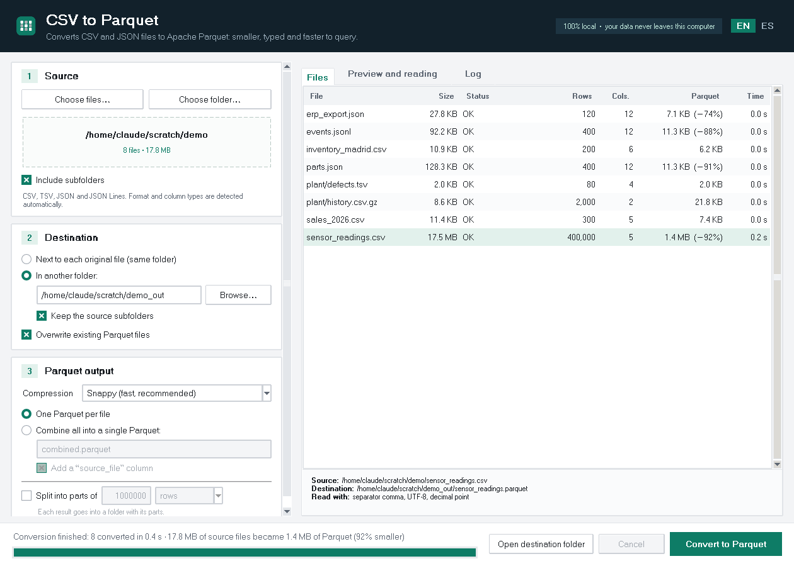
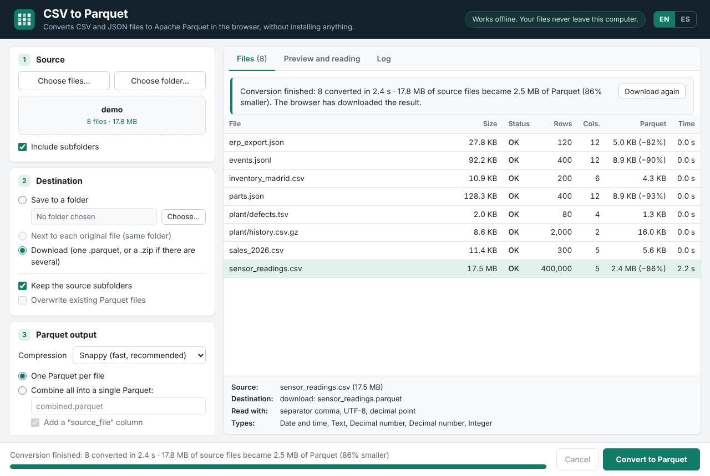
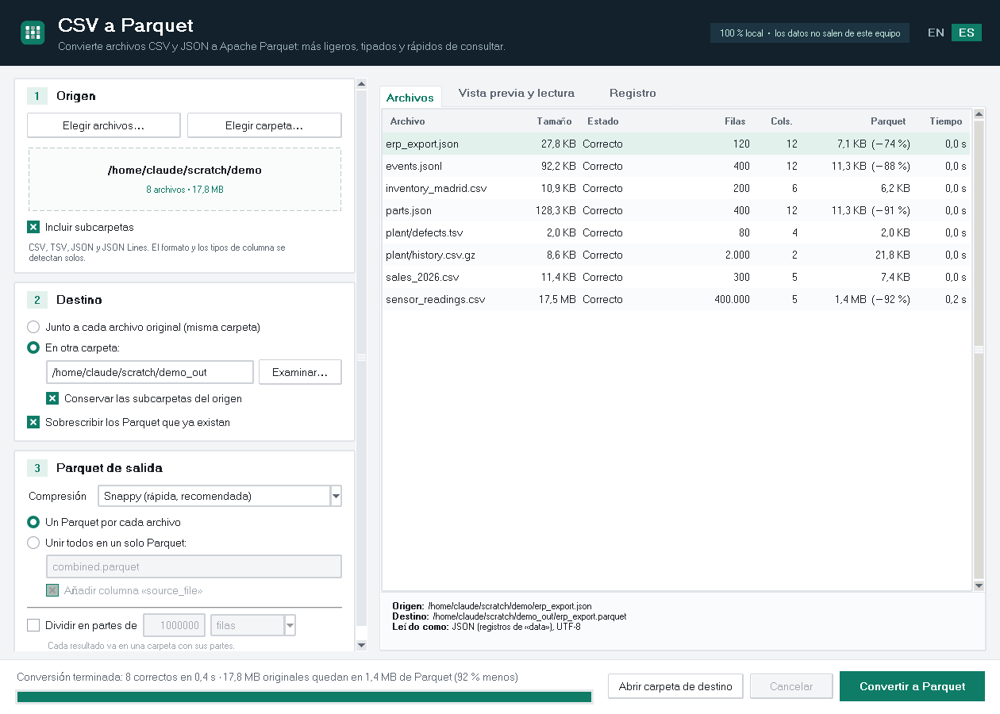
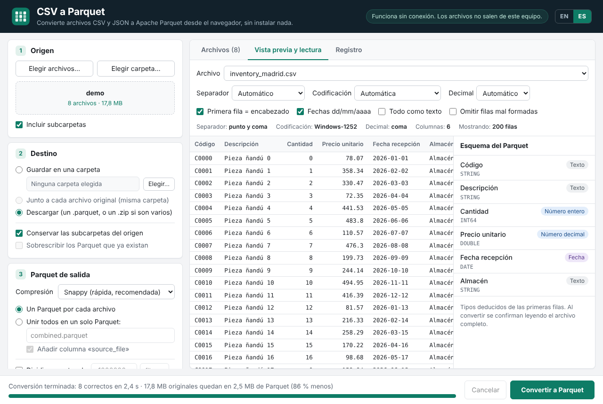

# CSV to Parquet

Convert **CSV and JSON** files to **Apache Parquet** — one file, many files or a whole folder (with subfolders) — on your own computer. Your data never leaves it. The result can also be split into several Parquet files.

The interface is available in **English and Spanish** (switch with the **EN / ES** buttons in the header).

| Desktop app | Browser version |
|---|---|
|  |  |
|  |  |

## Two versions, same interface

| | **Desktop app** (`desktop/`) | **Browser version** (`web/dist/csv-to-parquet.html`) |
|---|---|---|
| What you need | Python 3.9+ (or the Windows `.exe` from Releases) | Any modern browser. Nothing to install, works offline |
| Best for | Very large files, automation (command line) | Locked-down computers where you can't install Python or run an `.exe` |
| Speed (717 MB CSV) | ~4 s | ~1 min |
| Compression | Snappy, Zstandard, Gzip, none | Snappy, Gzip, none |

Both versions read the same formats, detect the same things and write the same data. For JSON the output is identical; for CSV see [differences](#differences-of-the-browser-version).

## Quick start

**No Python, no installs:** download `csv-to-parquet.html` from the [latest release](../../releases/latest) (or from [`web/dist/`](web/dist/csv-to-parquet.html) in this repository), save it anywhere and double-click it.

**Desktop app:** download the repository (*Code → Download ZIP*) and open the launcher in the `desktop` folder:

| System | What to do |
|---|---|
| **Windows** | Double-click `start_windows.bat`. You can also drop files or folders onto it. |
| **macOS** | Double-click `start_macos.command` (the first time: right-click → *Open*, because of macOS security). |
| **Linux** | `./start_macos_linux.sh` (on Ubuntu/Debian first: `sudo apt install python3-venv python3-tk`). |

The first run takes 1–2 minutes: it creates a private environment in `desktop/.venv` and installs `pyarrow`. After that it opens instantly. It does not touch your system Python.

Prefer to do it by hand?

```bash
pip install -r desktop/requirements.txt
python desktop/csv_to_parquet.py
```

**Windows without Python:** download `CSV-to-Parquet-windows.zip` from the [latest release](../../releases/latest), unzip it and run `CSV to Parquet.exe`.

## Usage in 3 steps

1. **Source** — *Choose files…*, *Choose folder…* or drag files/folders onto the window. Reads `.csv`, `.tsv`, `.json`, `.jsonl`, `.ndjson` and their `.gz` versions. CSV and JSON can be mixed.
2. **Destination** — next to each original file, or in another folder (optionally keeping the subfolders). The browser version can also download the result (one `.parquet`, or a `.zip` when there are several).
3. **Convert to Parquet**. The *Files* table shows rows, columns, final size (and parts, if split) for each file. Select a file to see its details or the reason for an error.

The **Preview and reading** tab shows the first rows and the schema (the type of each column) exactly as they will be written. You can adjust how the file is read there and see the effect immediately.

## What it detects automatically

**CSV**
- **Separator**: comma, semicolon, tab or pipe.
- **Encoding**: UTF-8 (with or without BOM) or Windows-1252 (Excel CSVs in Spanish and other Western European languages). If a file starts as UTF-8 but contains ANSI characters later on, it is retried as Windows-1252 automatically.
- **Decimal comma** (`12,5`) in semicolon-separated files.
- **Types**: integers, decimals, dates (ISO and `dd/mm/yyyy`), date-times, true/false and text.
- **Columns that change type** halfway through the file (e.g. a numeric code that is `N/A` in row 1,400,000): that column is stored as text and you are told.
- **Messy headers**: trims spaces, names empty columns (`column_3`) and renames duplicates (`Item_2`).

**JSON**
- **Three shapes**: a list of objects `[{…}, {…}]`; JSON Lines, one object per line (`.jsonl`, `.ndjson` or `.json`); or an object that wraps the list, like `{"data": [{…}, …], "total": 500}` — the first list of objects is used and its name is shown. A file with a single object becomes a one-row table.
- **Nested objects** are flattened into dotted columns: `{"customer": {"name": "…"}}` → `customer.name`.
- **Lists inside a record** (`"tags": ["a", "b"]`) are stored as JSON text (`["a","b"]`).
- **Keys missing from some records**: the column still exists and is empty where the key is missing.
- **Types**: integers, decimals and booleans are kept. Strings that look like dates (`2026-03-05`, `2026-03-05T10:00:00Z`, `05/03/2026`) become dates or timestamps (time zones are converted to UTC). An empty string in a date column counts as empty. Integers that don't fit in 64 bits are stored as text. A column that mixes numbers and text becomes text, and you are told.
- Large JSON files are read in blocks, without loading them into memory.

## Splitting the output

Tick **Split into parts of** and choose the size of each part:

- **rows**: each part has at most that many rows (e.g. 1,000,000).
- **MB (approx.)**: each part is about that size (e.g. 128). The size is approximate because it depends on compression, but it stays under the limit except in rare cases.

The parts of each result are saved in a folder named after it:

```
sales/sales_0001.parquet
sales/sales_0002.parquet
sales/sales_0003.parquet
```

If the file fits in one part, the folder is still created with `sales_0001.parquet`, so the output always has the same shape. With *Combine all into a single Parquet*, the combined file is what gets split.

Most tools read the whole folder as one table:

- **DuckDB**: `SELECT * FROM 'sales/*.parquet'`
- **pandas**: `pd.read_parquet('sales')`
- **Polars**: `pl.read_parquet('sales/*.parquet')`
- **Power BI**: *Folder* connector.

When **overwriting**, if the new conversion produces fewer parts than the previous one, the leftover parts are deleted so old and new data never mix. If *Overwrite* is not ticked and the folder already has parts, the file is marked as *Skipped*.

## Options

| Option | What for |
|---|---|
| Separator / Encoding / Decimal | Force a value if detection gets it wrong. Separator, decimal and header only apply to CSV. |
| First row = header | Untick it if the CSV has no column names (they will be called `column_1`, `column_2`…). |
| dd/mm/yyyy dates | Turns `31/12/2025` into a date (CSV and JSON strings). Untick it if your dates are mm/dd/yyyy. |
| Everything as text | No type detection: every column is text (maximum fidelity). |
| Skip malformed rows | CSV: skips rows with more or fewer columns than expected. JSON Lines: skips lines that are not a valid object. Says how many were skipped. Unticked, such rows stop the file with an error that points to them. |
| Compression | Snappy (fast, the usual choice), Zstandard (smaller, desktop only), Gzip or none. |
| Combine all into a single Parquet | Merges all the files into one. If a column has different types in different files it is stored as text; if it is missing from a file it is empty there. Can add a `source_file` column. |
| Split into parts of | Writes each result as several parts, by rows or by size (see above). |
| Overwrite existing Parquet files | Unticked, existing Parquet files are left alone and marked as *Skipped*. |

The desktop app remembers your options and language in `~/.csv_to_parquet.json`; the browser version remembers them in that browser.

## Large files

Files are read and written in blocks, so files larger than the computer's memory work. In tests:

- **717 MB CSV** (10 million rows): about 4 seconds in the desktop app, 197 MB of Parquet, under 400 MB of RAM.
- **230 MB JSON** (1 million records): about 27 seconds in the desktop app and 17 seconds in the browser, under 200 MB of RAM.

A half-written Parquet is never left behind: if something fails or you cancel, no file or part is left.

## Command line

The desktop engine also works without the interface:

```bash
python desktop/engine.py data/exports                          # next to each file
python desktop/engine.py data/exports -o parquet --compression zstd
python desktop/engine.py "data/**/*.csv" -o parquet --combine all.parquet
python desktop/engine.py data/events.json -o parquet --split-rows 1000000
python desktop/engine.py data/exports -o parquet --split-mb 128 --lang es
```

Run `python desktop/engine.py --help` for every option. The exit code is `1` if any file failed.

## GitHub Action

To convert files inside a GitHub workflow, use the companion action **[CSV and JSON to Parquet](https://github.com/marketplace/actions/csv-and-json-to-parquet)** (repository [`csv-to-parquet-action`](../../../csv-to-parquet-action)), which runs this same engine:

```yaml
- uses: OWNER/csv-to-parquet-action@v1
  with:
    path: data/**/*.csv
    output: parquet
```

## Browser version

`csv-to-parquet.html` is a single self-contained file. Copy it anywhere and double-click it. The conversion happens inside the browser: it makes no network connections and your files never leave the computer.

| Browser | Where it saves the Parquet files |
|---|---|
| **Microsoft Edge or Google Chrome** (recommended) | In a folder you choose, next to each original file, or as a download. The first time, the browser asks for permission to write to the folder. |
| Firefox or Safari | As a download only: one `.parquet`, or a `.zip` when there are several (parts go inside the `.zip` in their folder). |

If *Save to a folder* fails with a permission error, your organization may block folder access from the browser; use *Download* instead.

### Differences of the browser version

- **CSV column types**: the browser reads each CSV twice, once to decide each column's type from the whole file and once to write it. If a column mixes numbers and text, the log shows the first value that turned it into text.
- **CSV dates without time** in `dd/mm/yyyy` are stored as `DATE` (the desktop app stores them as a timestamp).
- **CSV codes with leading zeros** (`007`) are kept as text.
- **Speed**: in tests the 717 MB CSV took about a minute (the desktop app, about 4 s). For very large files use *Save to a folder*: with *Download* the result is kept in the browser's memory.
- **Compression**: Snappy, Gzip or none (no Zstandard).

## Troubleshooting

- **“Python 3.9 or later with Tkinter was not found”**: install Python from [python.org](https://www.python.org/downloads/) and tick *Add python.exe to PATH*.
- **pyarrow won't install (company network)**: the corporate proxy may block `pip`. Try `set HTTPS_PROXY=http://proxy:port` before running the `.bat`, or ask IT to install `pyarrow`. Then delete `desktop/.venv` and open the app again. Or use the browser version.
- **“No permission to read or write”**: the source file or the Parquet is open in another program (Excel locks the files it has open).
- **“The JSON is a list of plain values”**: the file is something like `[1, 2, 3]`; a table needs objects (`[{"value": 1}, …]`).
- **“There is content after the end of the JSON”**: it is probably one object per line; save it with the `.jsonl` extension.
- **Drag and drop doesn't work** (desktop): it is optional (`tkinterdnd2`); the buttons do the same.
- To reinstall from scratch, delete `desktop/.venv`.

## Repository layout

```
desktop/                 Desktop app (Python + Tkinter)
  csv_to_parquet.py        the interface
  engine.py                the conversion (also a command-line tool)
  i18n.py                  translations
  start_*.bat/.command/.sh launchers, build_windows_exe.bat, icon.ico
web/                     Browser version
  src/                     engine.js, app.js, i18n.js, index.html
  dist/csv-to-parquet.html the built single-file app (committed, ready to use)
  test/                    Node tests
locales/                 en.json and es.json, shared by both versions
tests/                   Python tests and their fixtures
.github/workflows/       CI and release
```

## Development

```bash
# Python (desktop engine) — tests also compare its output with the browser engine when Node.js is available
pip install -r requirements-dev.txt
pytest

# Browser version
cd web
npm ci
npm test
npm run build        # writes web/dist/csv-to-parquet.html — commit it together with the source
```

**Translations** live in `locales/<language>.json` and are shared by both versions. A string is plain text or a `{"one": …, "other": …}` pair for plurals, with `{placeholders}`. To add a language, add its JSON file and register it in `LANGUAGES` in `desktop/i18n.py` and `web/src/i18n.js`; the tests check that every language has the same keys and placeholders.

**Releases**: pushing a tag like `v1.0.0` runs `.github/workflows/release.yml`, which builds the Windows executable and attaches it, together with the browser HTML, to a GitHub Release.

## License

[MIT](LICENSE). The browser version bundles [hyparquet-writer](https://github.com/hyparam/hyparquet-writer) and [hyparquet](https://github.com/hyparam/hyparquet) (MIT, Hyperparam) and [fflate](https://github.com/101arrowz/fflate) (MIT, Arjun Barrett). The desktop app uses [Apache Arrow](https://arrow.apache.org/) (`pyarrow`, Apache-2.0) and, optionally, [tkinterdnd2](https://github.com/Eliav2/tkinterdnd2) (MIT).
